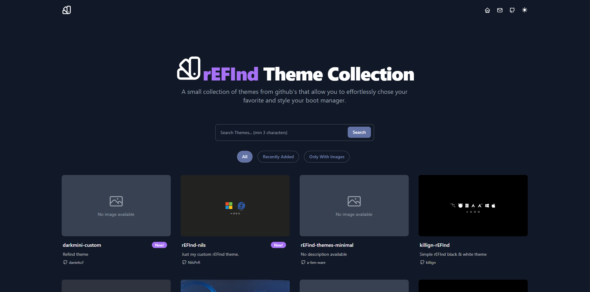

# rEFInd Themes Collection 🎨

A curated collection of clean, minimalist and colorful themes for the [rEFInd boot manager](https://www.rodsbooks.com/refind/).  
Preview themes live, browse screenshots, and get direct links to GitHub repositories.

🔗 **Website:** [refindthemes.com](https://refindthemes.com)

## 📌 About

[rEFInd](https://www.rodsbooks.com/refind/) is a versatile UEFI boot manager that supports custom themes to personalize your boot experience.  
This project showcases a handpicked collection of rEFInd themes for users looking to enhance the look and feel of their boot menus.

Whether you prefer dark, light, colorful or minimalist themes — this site gives you an easy way to explore and download them.

> 💡 **Tip:** To test and edit rEFInd themes interactively without rebooting, check out the [cachyos-bl](https://github.com/duangsuse/cachyos-bl/) project.

## 🚀 Features

- 🌐 One-page gallery with fast preview
- 📷 Full screenshots of each theme
- 🔗 Direct links to source repositories
- 📱 Mobile-friendly layout

## 🎥 Featured on YouTube

This project was mentioned in the video:  
▶️ **[4053 REFIND – 6 Themes to Choose From](https://www.youtube.com/watch?v=IvPUX0MFqqg)** by Arco Linux.

> The author explores different rEFInd themes and mentions this collection as a reference resource.

## 🤝 Submit Your Theme

Want to share your own rEFInd theme with the community?  
Feel free to open a [pull request](https://github.com/martinmilani/rEFInd-theme-collection/pulls) or [create an issue](https://github.com/martinmilani/rEFInd-theme-collection/issues) with a link to your repository.

Your work will be reviewed and, if accepted, added to the gallery with credit.

## 📄 License

This project is licensed under the [MIT License](https://opensource.org/licenses/MIT).

You are free to use, modify or share the code and website content. Attribution is appreciated.  
If you use or reference this collection, please consider linking back to the site:

## 🧞 Commands

All commands are run from the root of the project, from a terminal:

| Command                    | Action                                           |
| :------------------------- | :----------------------------------------------- |
| `pnpm install`             | Installs dependencies                            |
| `pnpm run dev`             | Starts local dev server at `localhost:4321`      |
| `pnpm run build`           | Build your production site to `./dist/`          |
| `pnpm run preview`         | Preview your build locally, before deploying     |
| `pnpm run astro ...`       | Run CLI commands like `astro add`, `astro check` |
| `pnpm run astro -- --help` | Get help using the Astro CLI                     |

## 📈 Popularity ranking

The "Popular" badges and filter are ranked by how often each theme's GitHub repo was clicked on the site in the last 90 days, using Google Analytics data. Before each build, `scripts/fetch-popularity.mjs` refreshes `src/data/popularity.json`. If GA credentials are missing or the request fails, it keeps the committed snapshot, so the build never breaks. A Netlify scheduled function (`netlify/functions/weekly-rebuild.mts`) rebuilds the site weekly so the ranking stays current.

One-time setup:

1. **Google Cloud:** create a project (or reuse one), enable the **Google Analytics Data API**, create a service account and download a JSON key for it.
2. **Google Analytics:** go to Admin → Property access management and add the service account's email as a **Viewer**.
3. **Netlify:** create a build hook for the `deploy` branch (Site configuration → Build & deploy → Build hooks), then add these environment variables:
   - `GA_PROPERTY_ID`: `226481728`
   - `GA_SERVICE_ACCOUNT_KEY`: the full contents of the JSON key
   - `BUILD_HOOK_URL`: the build hook URL

The next deploy log should then show `[popularity] wrote … links from the last 90 days`.

### Search and filter analytics

The gallery sends two GA events: `search` (`search_term`, `results_count`) and `select_filter` (`filter_name`). To report on them, register them once in GA under Admin → Custom definitions:

- `filter_name`: an event-scoped custom dimension
- `results_count`: a custom metric

Searches with `results_count = 0` show what visitors look for and can't find.
